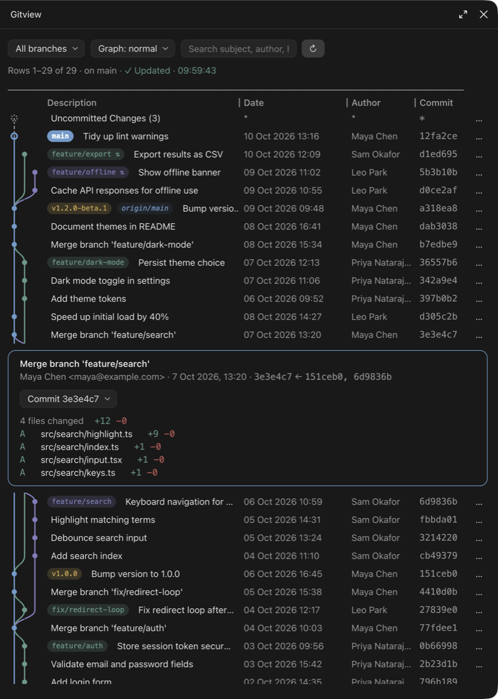
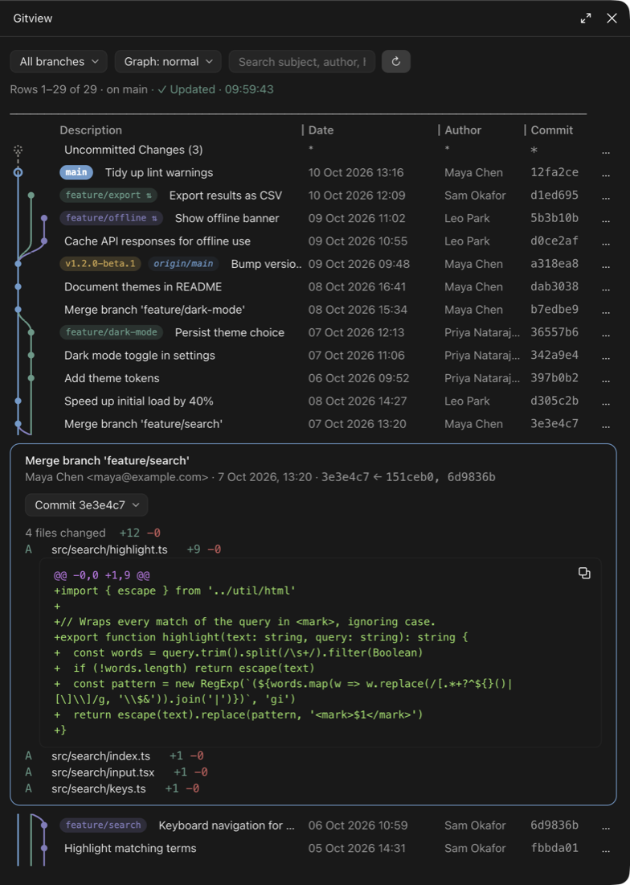
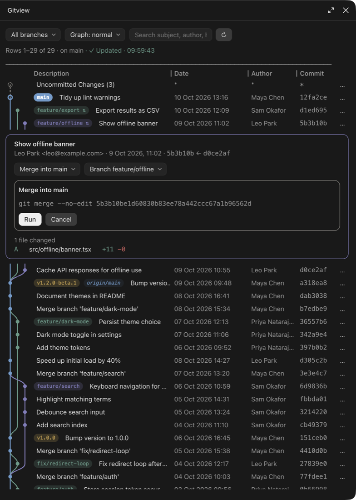
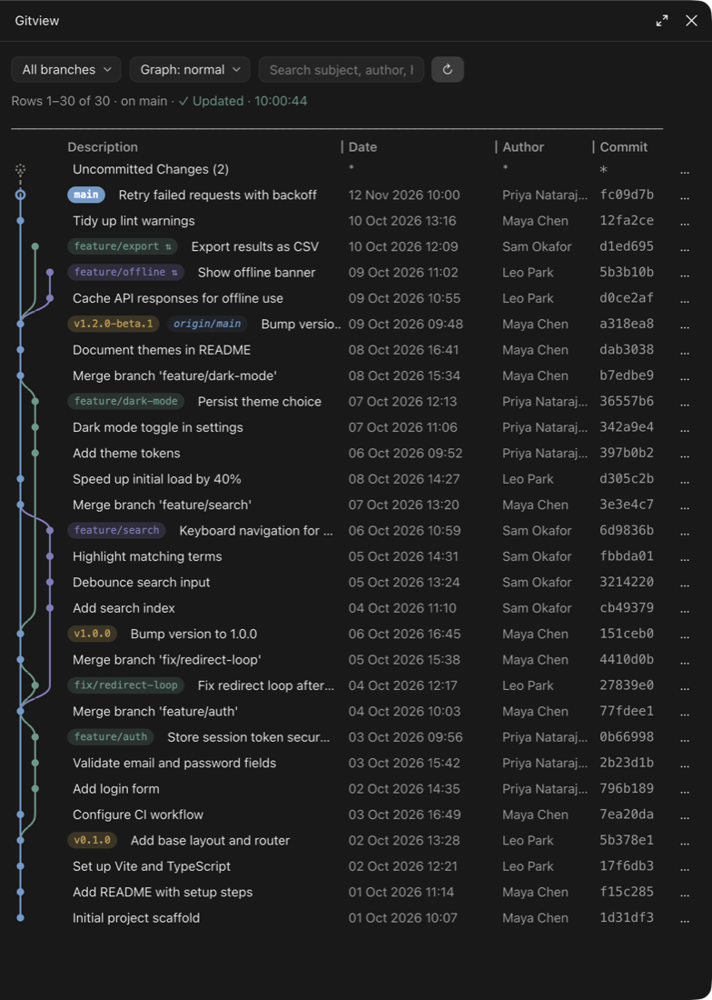
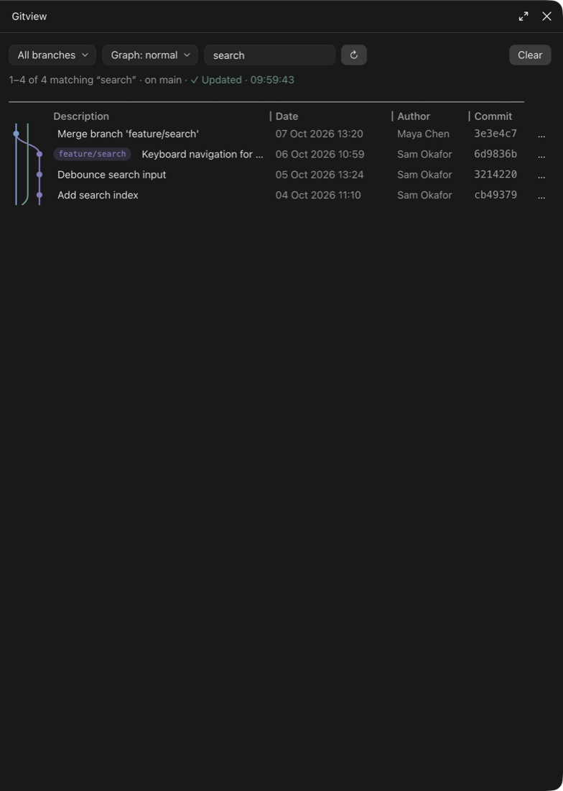
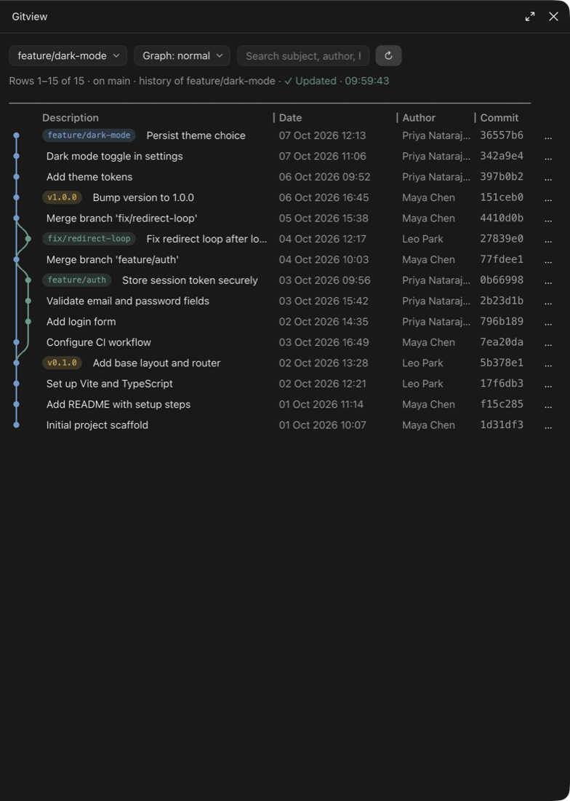
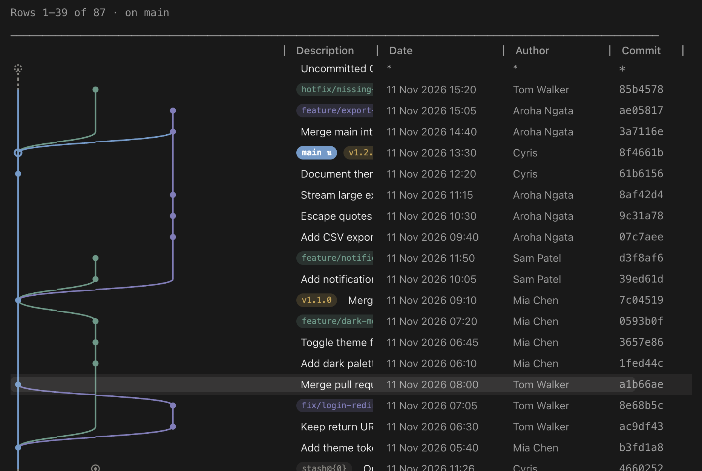
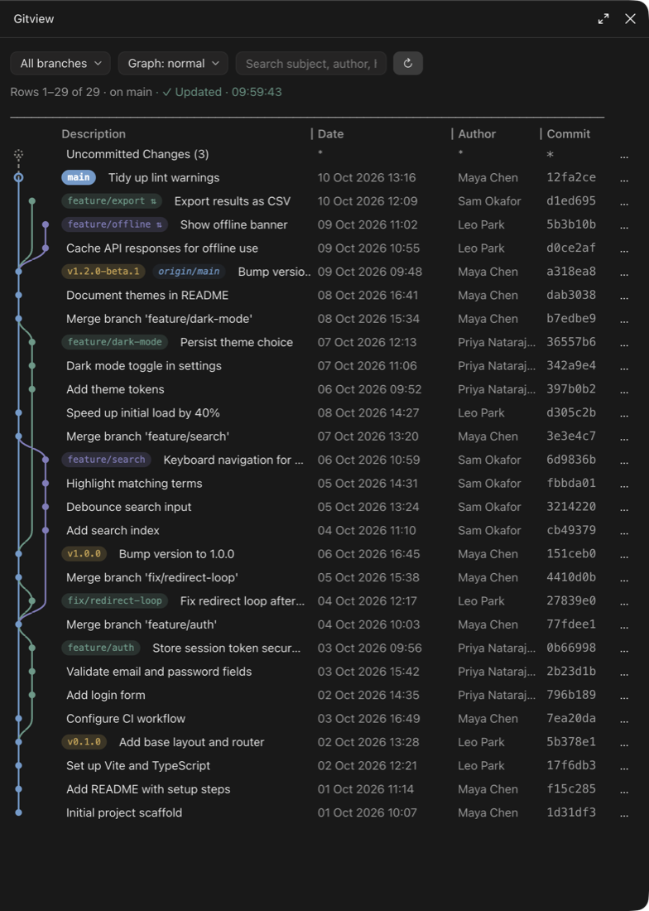
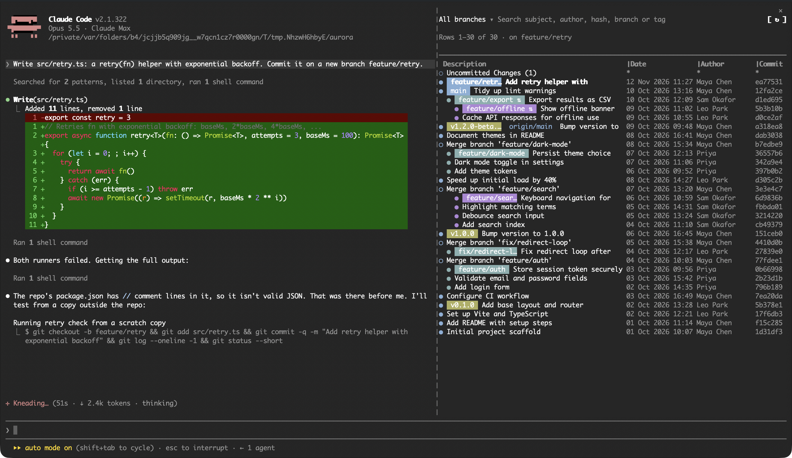

<p align="center">
  
</p>

<h1 align="center">Gitview</h1>

<p align="center">
  <strong>See what Claude is doing to your repository, as it happens.</strong><br>
  A live branch and commit graph that sits next to your chat in Claude Code.
</p>

<p align="center">
  <a href="#install">Install</a> ·
  <a href="#features">Features</a> ·
  <a href="#faq">FAQ</a> ·
  <a href="https://github.com/sponsors/CyrisXD">Sponsor</a>
</p>

<p align="center">
  
</p>

---

Claude commits, branches, merges and rebases faster than you can run `git log`. Gitview keeps the whole picture open beside the conversation: every branch, every merge, every tag, redrawn the moment something changes. Click any commit to see what it touched, read the diff, and act on it without leaving the chat.

- **Nothing to set up.** Open a session in a git repository and the pane is already there.
- **Never in the way.** It reads your history with plain `git` and changes nothing until you press Run.
- **Fits your Claude Code.** The colours, badges and layout match the app, in the desktop app and the terminal.

## Features

<table>
  <tr>
    <td width="50%" valign="top">
      
      <h3>Open any commit in place</h3>
      Click a row and it opens right where it is: subject, author, date, parents and every changed file with its added and removed lines. The graph keeps its place around it.
    </td>
    <td width="50%" valign="top">
      
      <h3>Read the diff without switching</h3>
      Click a file to see its diff inline, with a copy button. Click it again to fold it away.
    </td>
  </tr>
  <tr>
    <td width="50%" valign="top">
      
      <h3>Act from the graph, safely</h3>
      Dropdown menus on every commit, branch, tag and stash: check out, merge, rebase, cherry-pick, revert, reset, push, pull, stash and more. Each one shows the exact git command and waits for you to press <strong>Run</strong>.
    </td>
    <td width="50%" valign="top">
      
      <h3>Live, always</h3>
      The graph redraws after every Bash command Claude runs, and every 10 seconds besides. A commit Claude just made is already at the top when you look.
    </td>
  </tr>
  <tr>
    <td width="50%" valign="top">
      
      <h3>Find anything</h3>
      Search filters as you type, across subjects, authors, hashes and branch or tag names.
    </td>
    <td width="50%" valign="top">
      
      <h3>Follow one branch</h3>
      Narrow the graph to a single branch's history when the full picture is too much.
    </td>
  </tr>
  <tr>
    <td width="50%" valign="top">
      
      <h3>Room for busy histories</h3>
      Every column resizes like a spreadsheet's: drag a divider and the columns after it move along. Drag the graph's edge and its lanes spread to fill it, so a history with a dozen branches stays readable.
    </td>
    <td width="50%" valign="top">
      
      <h3>Everything at a glance</h3>
      Coloured lanes for every branch and merge, with badges for local branches, remote branches, tags and HEAD, and a row for uncommitted changes.
    </td>
  </tr>
</table>

### Works in your terminal too

<p align="center">
  
</p>

Run `claude` in any terminal and the pane docks beside the conversation, with the same graph, details, menus and live updates. Here Claude writes a retry helper and commits it on a new branch, and the commit is at the top of the graph before Claude has finished replying.


## Install

Gitview is a Claude Code plugin and needs git 2.24 or later on your PATH (`git --version`). It is tested on macOS; Windows support is written but untested. Add this repository as a marketplace and install it:

```
/plugin marketplace add CyrisXD/gitview-for-claude
/plugin install gitview@gitview
```

In the desktop app you can also click **+** next to the prompt, choose **Plugins**, then **Add marketplace**, and enter `CyrisXD/gitview-for-claude`.

## Usage

Start a session in any git repository. The Gitview pane opens on its own. If you close it, bring it back with:

```
/gitview
```

| Where | What you get |
| --- | --- |
| Desktop app | The full pane: drawn graph and badges, row hover, click anywhere on a row, dropdown menus, resizable columns, including the graph |
| Terminal | Each commit marked in its lane colour, with details, actions and resizable columns |

## FAQ

**Will it change my repository on its own?**
No. Gitview only reads until you choose an action and press **Run**. Git's own prompts and editors are turned off (`GIT_TERMINAL_PROMPT=0`, `GIT_EDITOR=true`), so nothing ever hangs waiting for input.

**What if the repository changes while a confirm step is open?**
Run reads the repository again first. If a branch, commit or stash moved since the step was shown (Claude or a terminal changed it), nothing runs and the pane redraws, so you never reset or drop something other than what you saw. Its automatic reads also ignore a repository's own fsmonitor, external diff and textconv settings, so opening a downloaded repository runs nothing from it.

**What does Continue stage after a conflict?**
Only the files that were in conflict, after checking none still holds conflict markers. Other edits in your working tree stay out of the commit.

**Does it send my code anywhere?**
No. It runs `git` on your machine in the session's folder. The only network traffic is a push or pull you start yourself.

**How much history does it load?**
200 commits at a time, with **Show older commits** at the bottom for more.

**Why are some remote branches missing from the graph?**
In a repository with more than 50 remote branches, **Remotes: auto** leaves out the history of remote branches you don't track locally, so the graph stays readable. Pick **Remotes: shown** to see them all, or choose one from the branch menu.

## Development

```
claude plugin validate .
claude plugin test .
```

`tsconfig.json` extends `.claude-plugin/types/tsconfig.json`, which Claude Code writes when it loads the plugin (for example with `claude --plugin-dir .`). After that, `npx tsc -p . --noEmit` type-checks the plugin. The generated types include the MCP tools your session has connected. With a very large number of them, tsc can stop with TS2589 on the `tool.call` hook, which says nothing about the plugin.

The test fixtures in `tests/fixtures/` are recorded from a scratch repository by `dev/record.ts`. To record them again, point `GITVIEW_PLAYGROUND` at a throwaway repository you can lose.

The screenshots and demo show a made-up project with made-up people.

## Support Gitview

<p>
  <a href="https://github.com/sponsors/CyrisXD"></a>
  <a href="https://buymeacoffee.com/FiRmVXOZh"></a>
</p>

Gitview is built and maintained by [@CyrisXD](https://github.com/CyrisXD). It's free and open source, and it'll stay that way.

If it saves you a few trips to `git log`, a [sponsorship](https://github.com/sponsors/CyrisXD) or a [coffee](https://buymeacoffee.com/FiRmVXOZh) helps keep it going: new features, fixes, and keeping up with each new Claude Code release. A star or an issue with an idea helps too.

## License

MIT. See [LICENSE](LICENSE).
